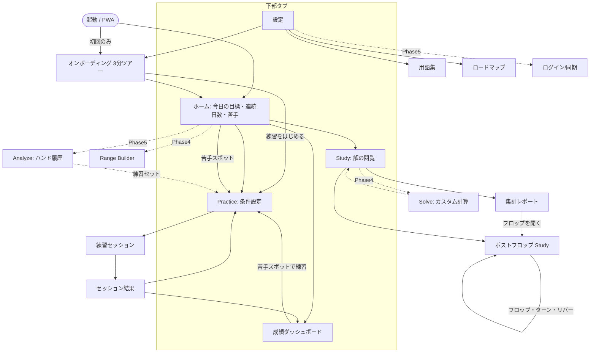
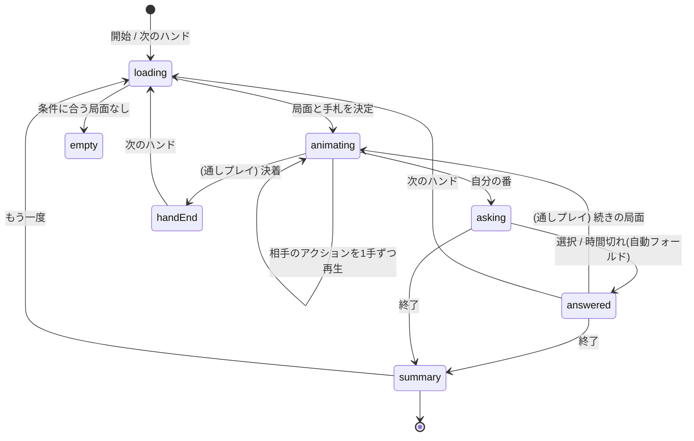
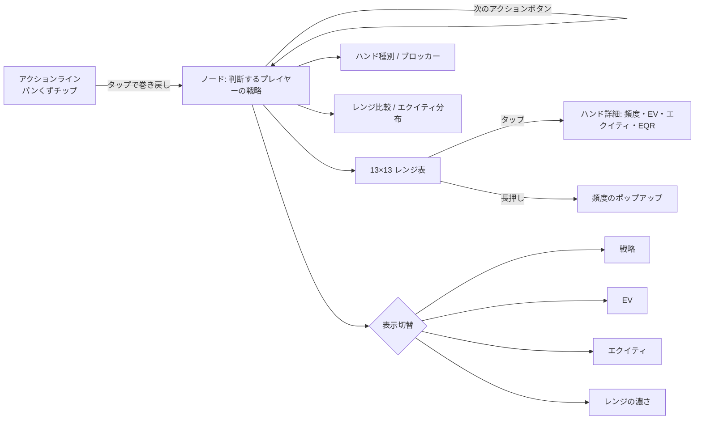

# 01. 画面遷移図

## 全体

実線＝Phase 2で実装済み、点線＝予定。

## Practice セッションの状態遷移

- **スポット練習**: 毎回ランダムな局面で1手だけ判断。
- **通しプレイ**: 手札が配られ、相手は解の頻度に従って自動で動き、自分の番ごとに採点。決着まで続く。
- **ポストフロップ練習**: スポット(ストリート指定)と通しプレイ(フロップ〜リバー、相手は解どおり)。プリフロップの通しプレイがヘッズアップのフロップに着くと「フロップへ進む」で続きから。
- **RNGモード**: 頻度と乱数(1–100)を表示し、乱数が指すアクションを選ぶ練習。乱数に従わなかった場合は判定が「不正確」以下に制限される。

## Study の操作

URLの `#n=<ノードID>` で局面を共有できる。
